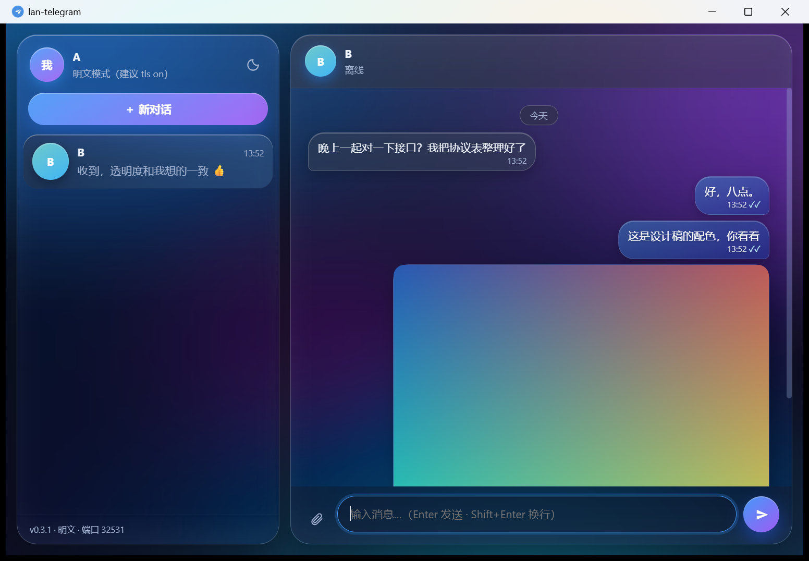

# lan-telegram

**局域网聊天工具：没有服务器中转、没有账号、没有互联网依赖。TLS 1.3 加密 + 证书指纹人工核对固定，消息只存在于两台机器上。**

Telegram 式的对话模型——会话、已读回执、离线补发、永久本地历史——桌面端用 Rust + WebView2，
协议引擎用纯 Python 标准库实现。


它与 [lan-sync](https://github.com/2778277877778/lan-sync) 互传工具是两个独立应用：lan-sync 是「传完就走」的一次性收发，
lan-telegram 是「持续对话」的聊天。

> 最新发布 **v0.4.0**（Telegram 风格界面 · IP 一眼可见 · 消息搜索 · 上传进度）。
> Windows 免安装成品见 [Releases](https://github.com/2778277877778/lan-telegram/releases)；下一里程碑 M5 群聊。

## 现在能做什么

- **桌面版**（Tauri + Liquid Glass 界面）：会话列表、气泡、✓/✓✓ 送达已读、未读徽标、
  在线点、图片缩略图、文件卡片、引用回复、向前翻页——双击 `lan-telegram-desktop.exe` 即用，无黑窗
- 两个实例互相发文本消息、文件与图片（原件+缩略图），历史永久保存在本地 SQLite
- 已读回执：对方看完，你这边状态从「已送达」变「已读」
- 消息幂等：同一条重复投递不会产生两条记录
- 离线队列：对方没开机时消息入队，指数退避（2/5/15/30/60 秒封顶）自动补发——**含附件的完整重传**
- 历史分页：按时间戳往前翻，不受内存限制
- **传输加密**：自签证书 + 证书指纹人工核对固定，配对后仅允许 TLS 1.3，
  未固定 / 换证书的连接在握手层直接拒绝；证书 CN 内嵌设备 ID，TLS 下 `from` 无法伪造

## 为什么需要它

同办公室/宿舍两台电脑传聊天记录，走微信/QQ 要过第三方服务器，走网盘要手动搬。
lan-telegram 的威胁面只有一层局域网：

- **零中转**——消息点对点 HTTP(S) 直连，永不出局域网
- **防偷听**——可选 TLS 1.3：自签证书 + 首次配对人工核对指纹固定，不依赖任何 CA
- **防中间人**——未固定的对端、换过的证书、核对不符的指纹：全部在握手层拒绝，绝不回退明文
- **防伪造**——证书 CN 内嵌设备 ID，TLS 下声明的发信人必须与对端证书一致，否则 403
- **离线不断聊**——对方没开机时消息入队，上线后按 2/5/15/30/60 秒退避自动补发
- **历史在你手里**——SQLite 本地永久保存，不自动清理，不上传

## 环境要求

- Python 3.8+（Windows / macOS / Linux）
- 仅启用 TLS 时需要 `cryptography`：`pip install cryptography`
  （不装也能跑：默认明文模式即 M1 行为，零第三方依赖）

## 快速开始

**Windows 用户推荐直接下载成品**（Releases 里的 zip）：解压后双击 `lan-telegram-desktop.exe`
——Liquid Glass 桌面界面，若引擎没在跑会在界面里一键无窗拉起，全程无黑框。

以下命令方式假设两台机器：本机与对端 `10.0.0.7`，局域网互通。每台机器各执行一遍。

### 1. 起接收服务

```powershell
python lantelegram.py serve --background
python lantelegram.py info          # 看设备名 / IP / 端口 / 密钥
```

### 2. 对齐应用层密钥

两台机器密钥必须一致，否则互相 401 拒收：

```powershell
python lantelegram.py pair --key <对方 info 里显示的密钥>
```

### 3. 收发第一条消息

```powershell
# 本机 → 对端
python lantelegram.py send --target 10.0.0.7 --text "在吗"

# 对端查看（看完自动把「已读」回执发回本机）
python lantelegram.py history
python lantelegram.py history --with <本机设备名或IP>
```

对方离线时这条 send 会自动入队，等对方上线补发——这就是「不断聊」。

### 4. 启用 TLS 1.3（推荐，需先装 cryptography）

顺序很重要：**先互相固定，再各自开启**。

```powershell
# 第 1 步（两台各自）：显示本机证书指纹，8 组十六进制
python lantelegram.py cert

# 第 2 步（两台各自）：当面/电话核对对方念给你的指纹后，固定对方证书
python lantelegram.py trust --target 10.0.0.7:32200 --expect A1B2-C3D4-E5F6-7788-…

# 第 3 步（两台各自）：切换 TLS 并自动重启服务
python lantelegram.py tls on
```

指纹核对不符时 `trust` 会拒绝落盘——**这人工一步就是防中间人的全部**，
之后每次握手的信任锚只有这份核对过的证书。`tls off` 可退回明文；
`trust --list` 查看固定记录，对方换证书（重装等）后 `trust --remove <旧指纹前缀>` 重新配对。

## 命令参考

| 命令 | 作用 |
|---|---|
| `serve [--port N] [--background]` | 启动接收服务。`--port` 在前台启动时写入配置；端口被占自动 +1（上限 20 次），以 `info` 为准 |
| `stop` / `status` / `info` | 停止 / 状态 / 本机信息（含传输模式与指纹） |
| `send --target IP[:端口] --text "…" [--file 路径]` | 发消息或文件/图片（`.png/.jpg/.gif/.webp/.bmp` 按图片处理）；对方离线自动入队补发（含附件重传） |
| `getfile --msg ID --out 路径` | 把本机存过的附件（收到的或发出的）导出到指定路径 |
| `history [--with 设备] [--limit N] [--before TS]` | 会话列表 / 具体聊天记录（看完自动回执已读）；`--before` 按时间戳向前翻页 |
| `contacts` | 已联系过的设备（IP/端口/最近出现） |
| `key [--new]` / `pair --key K` | 查看 / 随机换 / 对齐应用层密钥（换 key 自动重启服务） |
| `cert` | 查看/生成本机自签证书与指纹 |
| `trust --target IP[:端口] --expect 指纹` | 核对并固定对端证书；另有 `--pem 文件`（离线导入）、`--list`、`--remove 前缀` |
| `tls on` / `tls off` / `tls` | 启用 / 关闭 TLS 1.3（on 要求至少固定了一个对端；运行中服务自动重启） |

## 安全模型

**TLS 模式（推荐）**

- 协议版本强制 `min = max = TLS 1.3`（X25519 密钥协商，AES-256-GCM / ChaCha20-Poly1305，前向保密）
- 证书：Ed25519 自签，`BasicConstraints CA:TRUE` 自锚，CN = `lan-telegram/<设备ID>`，有效期 10 年
- 信任链：你人工核对并固定的那份证书是**唯一信任锚**，不走系统 CA、不认任何「正证书」
- 双向认证：服务器同样要求客户端出示证书——未固定的一方连握手都过不去（TLS alert 拒绝）
- 身份绑定：`hello` / `messages` 声明的设备 ID 必须等于对端证书 CN（不符 403），
  堵掉明文时代「随便填 from 冒充别人」的空洞

**明文模式（默认，即 M1）**

- 应用层密钥 `X-Sync-Key`（8 字节随机 hex）解决「发错人」，**不解决偷听**：同网段抓包可直接读
- 适合先试跑链路；正式聊天请开启 TLS

**当前版本的边界**

- 密钥校验无速率限制与锁定（暴力尝试理论可行——请用 `key --new` 换足随机性的密钥）
- 设备 IP 会变：靠再次 `send`/hello 自动刷新记录；跨子网需手填地址
- 群聊（M5）为成员间扇出投递，最终一致而非全局严格排序

## 数据布局

```
%USERPROFILE%\.lan-telegram\        ← 环境变量 LAN_TG_HOME 可覆盖（macOS/Linux 为 ~/.lan-telegram）
├── config.json      设备 ID / 名称 / 端口 / 应用密钥 / TLS 开关
├── messages.db      SQLite：设备、会话、消息、回执、待发队列、事件流
├── state.json       运行状态（PID / 主端口 / 本机接入口端口）
├── server.log       服务日志
├── attachments/     文件与图片原件（按消息 UUID 命名）+ .thumb 缩略图
└── certs/
    ├── cert.pem     本机自签证书（把它的指纹念给对方）
    ├── key.pem      本机私钥（留在本机，永不外发）
    └── pins/        已固定的对端证书（按指纹命名，pins.json 记录来源与时间）
```

聊天记录永久本地保存：不自动清理、不上传、卸载程序时整个目录删掉即可清干净。

## 协议一览

HTTP 点对点，端点前缀 `/api/v2`：

| 端点 | 方法 | 说明 |
|---|---|---|
| `/ping` | GET | 探活，返回设备信息（免密钥；TLS 下附带证书指纹） |
| `/cert` | GET | 本机证书 PEM 与指纹（公开信息，免密钥——配对阶段双方还没有共享密钥） |
| `/hello` | POST | 握手：交换设备 ID / 名称 / 端口 |
| `/messages` | POST | 投递文本消息，按消息 UUID 幂等去重（重复投递只入库一条） |
| `/upload` | POST | 投递文件/图片：原始字节流 + 元数据头部；按消息 UUID 去重，≤500 MB |
| `/file?msg=&thumb=` | GET | 取附件原件或缩略图（渲染/另存/打开用） |
| `/send` `/conversations` `/contacts` `/read` | POST/GET | 界面层动作（见下「本机接入口」） |
| `/events?since=N` | GET | 长轮询增量事件（最多挂 25 秒），驱动界面实时刷新 |
| `/ack` | POST | 已读回执 |
| `/history` | GET | 分页拉历史 |

**本机接入口**：引擎除对等主端口外，固定另开一个 `127.0.0.1` 明文接入口（默认主端口+1，
实报于 `state.json.local_port`），只服务界面类端点、拒绝对等协议——桌面壳因此不需要
持有任何证书，TLS 模式下面板照常工作；引擎重启/端口漂移时，壳按候选端口自动探活重新发现。

鉴权用 `X-Sync-Key` 头（或 `?key=`）。为什么用长轮询而不是 WebSocket、双时间戳防乱序、
群聊扇出方案等设计取舍，见 [docs/lan-telegram-design.md](docs/lan-telegram-design.md)。

## 测试与排障

三个验收脚本都是「同机起两个独立数据目录的实例」互测，可重复运行：

```powershell
# Windows GBK 控制台必须先切 UTF-8，否则脚本打印中文诊断会崩（与测试结果无关）
$env:PYTHONUTF8="1"

python tests/m1_check.py       # M1 验收 12/12：收发/已读回执/幂等/分页/重启不丢/离线入队
python tests/resend_check.py   # 离线队列自动补发
python tests/m2_check.py       # M2 验收 13/13：指纹配对/TLS1.3 强制/明文与 TLS1.2 拒绝/错指纹拒连
python tests/m3_bridge_check.py # M3 验收 19/19：GUI 端点契约/接入口隔离/TLS 下界面链路
python tests/m4_files_check.py  # M4 验收 13/13：文件图片/幂等/缩略图/离线附件重传/上限
```

常见问题：

| 现象 | 处理 |
|---|---|
| 发送报 401 | 两端密钥不一致：`pair --key <对方密钥>` |
| TLS 握手失败 / 提示证书不符 | 对方证书已更换：`trust --remove <旧指纹前缀>` 后重新核对 `cert` 指纹并 trust |
| 一方开了 TLS 就都连不上 | 设计如此，**不会降级**。双方都要完成 trust + tls on |
| 端口不是 32200 | 被占用时自动 +1，以 `info` 显示为准；桌面壳会按候选端口自动探活找到引擎，无需人工对齐 |
| 桌面壳显示「本机引擎没有在运行」 | 点「启动服务」或按 Alt+S，无窗口拉起；已双击 `lantelegram.exe serve` 的话它 4 秒内会自动重连 |
| 发图片对方只看到文件名没看到图 | 那是 CLI 发的（无缩略图），点开即用系统查看器打开；桌面端发的图片自带缩略图 |
| 报「还没有固定任何对端证书」 | `tls on` 的前置条件：先完成至少一次 trust |

## 路线图

- [x] **M1** SQLite 存储 + V2 协议 + 命令行 —— 验收 12/12
- [x] **M2** TLS 1.3 + 自签证书 + 指纹固定 —— 验收 13/13
- [x] **M3** 桌面图形界面 —— Tauri 2 壳 + Liquid Glass 视觉（改投 webview 方案而非 Tkinter：
      动画/滚动/图片渲染由 Chromium 承担，性能与观感都更好；Rust 只做桥接，webview 零出网）—— 验收 19/19
- [x] **M4** 文件与图片、缩略图、断线重传、上传进度 —— 验收 13/13
- [x] **M5（部分）** 消息搜索 + 发送进度 —— 验收 19/19；群聊待做
- [x] **M6** Windows 独立 exe —— v0.4.0 Release 双 exe 分发（macOS/Linux 打包待做）

每个里程碑独立发版，每个阶段都有可复跑的验收标准（见设计文档 §9）。

## 与 lan-sync 的关系

[lan-sync](https://github.com/2778277877778/lan-sync) 是「传完就走」的局域网互传工具（文本+文件+GUI+网页端，v1.1.4 稳定）。
本项目源自它的传输骨架（HTTP 服务、密钥认证、打包链路），自 v0.1.0 起拆分为独立仓库、独立发版：
端口不同（32200 / 32100），数据目录不同（`.lan-telegram` / `.marvis-lan-sync`），互不影响，可同时运行。

## 许可证

[GNU General Public License v3.0](LICENSE)（GPL-3.0-only）。

你可以自由使用、修改、分发本软件；若分发修改后的版本，需以同一许可证开源。
详细条款见 [LICENSE](LICENSE)。

## 贡献

欢迎 issue 与 PR。跑测试前请先读「测试与排障」一节（Windows 需 `$env:PYTHONUTF8="1"`）；
提交前确保 `tests/` 下五个验收脚本全绿。
